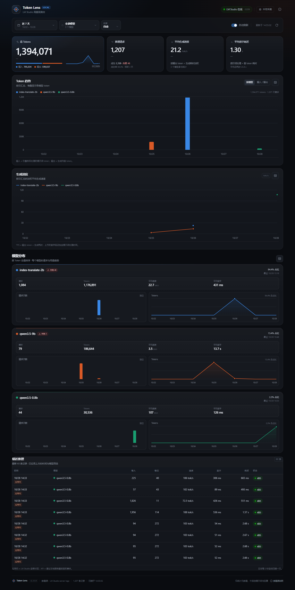
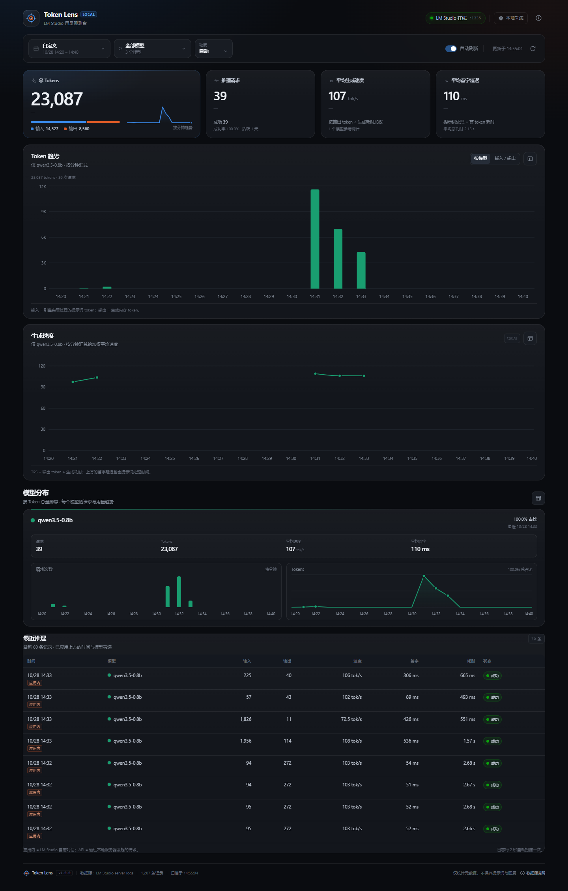

# Token Lens

**LM Studio 本地模型的 Token 用量与速度观测台。**

Token Lens 直接读取 LM Studio 写在本机的 server 日志，把每次推理的模型、输入 / 输出 token、生成速度、首字延迟整理成 SQLite 数据，并用一个现代化的深色仪表盘展示。**不需要反向代理，不需要修改任何客户端的 API 地址，也不用 Python。**



分钟级窗口示例（自定义 `14:20 – 14:40`，按分钟汇总）：



## 功能

- **零侵入采集**：自动发现并增量解析 LM Studio 的 `server-logs`，同时覆盖本地服务器 API 调用和 LM Studio 应用内对话。
- **用量总览**：总 Tokens、输入 / 输出 Tokens、推理请求数、成功率、平均生成速度、平均首字延迟。
- **分钟级时间窗口**：近 15 分钟、近 1 小时、近 6 小时，或自定义开始 / 结束时间（精确到分钟）；图表粒度可选自动 / 分钟 / 小时 / 天。
- **时间范围筛选**：分钟窗口、今日、近 7 天、近 30 天、本月、全部、自定义日期时间；自动模式在短窗口下使用分钟桶，长范围使用小时 / 天桶。
- **模型维度**：按模型拆分 Token 趋势、请求次数、平均 TPS、占比与最近使用时间；模型颜色稳定，不会因筛选而重新上色。
- **趋势图**：按模型或按输入 / 输出的堆叠柱状图、按模型的 TPS 折线图。
- **明细数据**：每个图表都有对应的数据表视图；最近 60 条推理记录包含模型、输入 / 输出、速度、首字延迟、耗时与状态。
- **开箱即用**：服务端零运行时依赖（Node 内置 `http` + `node:sqlite`），前端已构建好；双击 `start.bat` 即可在 Windows 上启动。
- **隐私优先**：只提取统计元数据，不保存提示词或模型回复；数据只在本机 SQLite 中。

## 为什么可以“零配置”统计 LM Studio？

LM Studio 本身没有提供历史用量 API，但它的本地服务器会把每次推理的引擎耗时写入日志，其中包含类似下面的行：

```text
[2026-10-25 19:58:16][DEBUG] ... prompt eval time = 8850.33 ms / 11201 tokens (... 1265.60 tokens per second)
0.20.994.756 I slot print_timing: id 0 | task 0 | eval time = 3214.70 ms / 62 tokens (... 18.98 tokens per second)
[2026-10-25 19:58:16][INFO][qwen3.5-9b] Finished streaming response
```

Token Lens 解析这些行，再结合 `[INFO][模型名]` 标记和 `launch_slot_` 任务号，还原出每次推理的模型、token 数和速度。LM Studio 应用内对话虽然没有 HTTP 请求标记，也会留下同样的计时行，因此同样可以被统计。

## 环境要求

- **Node.js 22.5 或更高版本**（推荐 Node.js 24 LTS；本项目在 Node 24.20.0 上测试）。
  - 项目启动脚本会自动带 `--experimental-sqlite` 参数，兼容 Node 22.5+。
- LM Studio 已安装，并且本地服务器在写 `server-logs`。
- Windows / macOS / Linux 均可。Windows 可直接双击 `start.bat`。

## 快速开始

### Windows

1. 打开 LM Studio，启动本地服务器（Developer → Start Server），或者直接使用应用内对话。
2. 双击项目根目录下的 `start.bat`。
3. 浏览器会自动打开 <http://127.0.0.1:1236>。
4. 正常使用本地模型，数据会在 2 秒内自动出现。

启动窗口需要保持打开；关闭窗口即停止服务。

### macOS / Linux

```bash
./start.sh
```

或者：

```bash
npm start
```

然后访问 <http://127.0.0.1:1236>。

> 仓库中已经包含构建好的 `web/dist`，所以运行时**不需要** `npm install`。只有修改前端源码或重新构建时才需要安装依赖。

## 第一次使用 / 没有数据？

Token Lens 会按以下顺序查找日志目录：

- Windows: `%USERPROFILE%\.lmstudio\apps\bionic\server-logs`
- Windows（旧版 LM Studio）: `%USERPROFILE%\.lmstudio\server-logs`
- macOS / Linux: `~/.lmstudio/apps/bionic/server-logs`、`~/.lmstudio/server-logs`

如果页面显示“还没有捕获到推理记录”：

1. 确认 LM Studio 本地服务器已启动，或已经用应用内对话产生过推理。
2. 确认 LM Studio 的日志级别足够详细。LM Studio 的 Developer / 开发者设置中有一个运行时日志级别选项，调到 **Verbose**；日志里出现 `print_timing` 行就说明满足条件。
3. 如果日志在别处，手动指定目录：

```bash
npm start -- --logs "C:\Users\你\.lmstudio\apps\bionic\server-logs"
```

也可以先运行一次导入检查：

```bash
npm run scan
```

它会打印日志目录、记录数、模型明细和时间跨度。

第一次启动会导入已有的全部历史日志；之后每 2 秒增量扫描一次，已经导入的数据会保存在 SQLite 中。

## 界面说明

- **顶部筛选行**：时间范围、模型筛选、图表粒度（自动 / 分钟 / 小时 / 天）、自动刷新开关、最后更新时间、手动刷新按钮。所有卡片、图表和表格都跟随同一组筛选条件。
  - 分钟窗口（近 15 分钟、近 1 小时、近 6 小时）是滚动窗口，开启自动刷新后会随时间向前移动。
  - 自定义范围使用带分钟的时间输入，例如 `2026-10-28T14:20` 到 `2026-10-28T15:20`。
- **总览卡片**：总 Tokens（含输入 / 输出拆分）、推理请求与成功率、平均生成速度、平均首字延迟。右侧的迷你曲线是所选时间范围的 Token 趋势。
- **Token 趋势**：默认按模型堆叠；也可以切换为“输入 / 输出”拆分。右上角可以切换为数据表。
- **生成速度**：每个时间桶按输出 token 加权的平均 TPS 折线图，支持多模型对比；同样有数据表视图。
- **模型分布**：每个模型一张卡片，包含请求次数和 Token 两个迷你趋势图；点右上角图标可查看模型汇总表。
- **最近推理**：最新 60 条记录，区分 API 请求和应用内对话（标签为“API”/“应用内”）。
- **数据源说明**：右上角信息图标可以看到监听目录、扫描状态、统计口径和隐私说明。

### 时间粒度

- **自动**（默认）：范围不超过 2 小时按分钟；不超过 2 天按小时；更长按天。
- **分钟**：可用于不超过 24 小时的范围；更长范围会自动降级为小时（粒度标签会提示“已用小时”）。
- **小时**：可用于不超过 90 天的范围；更长范围自动降级为天。
- **天**：按本地日期聚合。

分钟级时间在数据库中单独建桶，历史记录会在升级后自动补齐，不需要重新导入日志。

## 指标口径

| 指标 | 含义 |
| --- | --- |
| 输入 Tokens | 引擎实际处理的提示词 token（`prompt eval`）。开启提示词缓存时，可能小于客户端发送的完整上下文。 |
| 输出 Tokens | 模型实际生成的 token（`eval`）。 |
| 推理请求 | 一次引擎生成，包括 API 调用和应用内对话。失败请求也会单独计入请求数。 |
| 平均生成速度 | `输出 tokens ÷ eval time`，多请求按 token 数加权。 |
| 平均首字延迟 | 提示词处理时间 + 生成第一个 token 的时间。长上下文模型会明显偏高。 |
| 成功率 | `成功请求 ÷ 总请求`。 |
| 失败请求 | 来自日志中的 `ERROR` 行；有些失败没有 token 明细，会以 0 token 计入。 |

统计口径是**引擎实际处理 / 生成的 token**，不是任何 API 的计费口径；对本地模型来说这通常也是最有参考价值的口径。

## 配置

```bash
npm start -- [选项]
# 或者 Windows:
start.bat [选项]
```

| 选项 | 默认值 | 说明 |
| --- | --- | --- |
| `--port` | `1236` | Web 服务端口 |
| `--host` | `127.0.0.1` | 监听地址；默认仅本机可访问 |
| `--logs` | 自动探测 | LM Studio `server-logs` 目录，可重复或逗号分隔 |
| `--db` | `data/token-counter.db` | SQLite 数据库路径 |
| `--no-open` | - | 启动后不自动打开浏览器 |
| `--rebuild` | - | 清空数据库并重新导入全部日志 |
| `--scan-only` | - | 只导入并打印统计，不启动 Web 服务 |
| `--dev` | - | 开发模式（配合 Vite） |
| `--quiet` | - | 不输出扫描日志 |
| `--help` | - | 显示帮助 |

环境变量：`TOKEN_COUNTER_PORT`、`TOKEN_COUNTER_HOST`、`TOKEN_COUNTER_DB`、`TOKEN_COUNTER_NO_OPEN`。

示例：

```bash
# 换一个端口
npm start -- --port 1240

# 手动指定日志目录
npm start -- --logs "D:\LMStudio\server-logs"

# 重置统计并重新导入
npm start -- --rebuild

# 只扫描一次，看看导入了什么
npm run scan
```

## 数据与隐私

- 只提取模型名、token 数、耗时和状态等元数据；**不会把提示词或回复内容写入数据库**。
- 数据库默认位于 `data/token-counter.db`。删除该文件后重启即可清空统计；日志源文件不会被修改或删除。
- 页面默认只监听 `127.0.0.1`，没有登录鉴权。如果改成 `--host 0.0.0.0`，请只在可信网络中暴露。
- 数据不会上传到任何外部服务。

## 开发

```bash
npm install          # 安装前端开发依赖
npm run dev          # API 在 1236，Vite 前端在 http://127.0.0.1:5179
npm run build        # 构建前端到 web/dist
npm test             # 解析器 + 统计 SQL 测试
npm run typecheck    # TypeScript 类型检查
npm run scan         # 只导入日志并打印统计
```

### 目录结构

```text
server/
  index.js        HTTP 服务、API、静态资源、启动流程
  config.js       CLI 参数与日志目录探测
  parser.js       LM Studio 日志解析器（核心）
  ingest.js       增量扫描与读取日志
  db.js          SQLite schema 与批量写入
  stats.js       仪表盘聚合查询
  lmstudio.js    LM Studio 在线状态探测

web/
  src/           React + TypeScript + Recharts 前端
  dist/          预构建产物（开箱即用所需）
  vite.config.ts

test/
  parser.test.js 日志解析单元测试
  stats.test.js  聚合 SQL 与时间范围测试

start.bat         Windows 启动脚本
start.sh          macOS / Linux 启动脚本
data/             SQLite 数据库（gitignore）
```

## 常见问题

**页面提示“前端资源尚未构建”**

说明 `web/dist` 不存在。运行：

```bash
npm install
npm run build
```

或者直接使用仓库里已经构建好的版本。

**端口 1236 被占用**

```bash
npm start -- --port 1237
```

**LM Studio 显示未连接，但历史数据还在？**

这是正常的。LM Studio 在线状态只影响顶部的状态点；统计完全来自已经写入磁盘的日志，不依赖 LM Studio 服务实时在线。

**启动时报 `node:sqlite` 相关错误**

请升级到 Node.js 22.5+，并使用 `npm start` / `start.bat`（它们会自动带 `--experimental-sqlite`）。不建议直接运行 `node server/index.js`，除非你的 Node 版本已经默认启用 `node:sqlite`。

**日志目录找错了 / 使用了自定义数据目录**

用 `--logs` 指定实际目录，可以同时监听多个：

```bash
npm start -- --logs "D:\LMStudio\server-logs,E:\LM Studio\server-logs"
```

**应用内对话的模型名显示为“未识别模型”**

应用内对话的日志没有模型名标记，Token Lens 会尝试从最近加载的模型路径推断；如果推断不出，会归到“未识别模型”。通过本地服务器 API 发起的请求有明确的模型标记，不受影响。

**统计数据和 API 返回的 usage 不完全一致**

Token Lens 使用引擎日志中的实际处理量；提示词缓存、失败请求等原因会让它和客户端看到的 usage 存在差异。对本地模型观测来说，这个口径更接近 GPU 实际做了什么。

## 已知限制

- LM Studio 的日志格式可能随版本变化；如果未来版本改了 `print_timing` 等行格式，解析器需要同步更新。
- 主要统计生成式推理；embedding / rerank 等没有生成计时的请求可能不会出现在统计中。
- 没有按会话、客户端或 API Key 的维度；LM Studio 本地日志里没有这些信息。
- 分钟粒度最多支持 24 小时范围，小时粒度最多 90 天；超出时会自动使用更粗的粒度，避免图表和查询过重。
- 没有内置鉴权，默认仅监听本机。
- 数据保留期取决于本地日志和 SQLite 数据库；删除数据库会丢失已导入的历史。

---

如果这个工具对你有帮助，欢迎按自己的使用习惯调整 `web/src` 里的界面和 `server/parser.js` 的采集规则。
